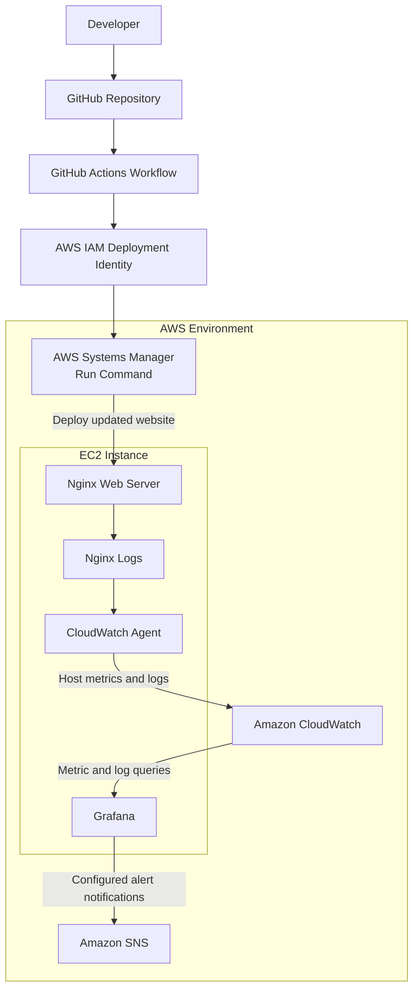

# AWS Monitoring and Observability Platform

An AWS-based observability project demonstrating infrastructure monitoring, metrics collection, alerting, and automated deployments using Amazon EC2, Amazon CloudWatch, Grafana, Amazon SNS, and GitHub Actions.

## Table of Contents

1. [Architecture](#1-architecture)
2. [Why Each AWS Service Exists](#2-why-each-aws-service-exists)
3. [Network Design](#3-network-design)
4. [IAM Design](#4-iam-design)
5. [Monitoring Design](#5-monitoring-design)
6. [Alert Strategy](#6-alert-strategy)
7. [Deployment Strategy](#7-deployment-strategy)
8. [Failure Testing](#8-failure-testing)
9. [Security Considerations](#9-security-considerations)
10. [Cost Considerations](#10-cost-considerations)
11. [Future Improvements](#11-future-improvements)

---

## 1. Architecture

The platform combines AWS-native monitoring services with Grafana dashboards and a GitHub Actions CI/CD pipeline.

The system collects Linux host metrics and configured application logs, visualises infrastructure performance, evaluates alert conditions, and automates website deployments.

### Architecture diagram

### Key components

- **GitHub Actions:** Validates website changes and automates deployments.
- **AWS Systems Manager:** Executes deployment commands on EC2 without requiring SSH for CI/CD.
- **Amazon EC2:** Hosts the website and monitoring components.
- **Nginx:** Serves the website and produces access and error logs.
- **CloudWatch Agent:** Collects configured host metrics and log files.
- **Amazon CloudWatch:** Stores telemetry and provides a data source for monitoring.
- **Grafana:** Provides dashboards and alert rules.
- **Amazon SNS:** Delivers notifications from the configured Grafana alert contact point.

## 2. Why Each AWS Service Exists

| Service | Purpose |
|---|---|
| Amazon EC2 | Hosts the website and monitoring environment. |
| Amazon VPC | Provides network isolation and connectivity. |
| Public subnet | Hosts the EC2 instance within a subnet with a route to the Internet Gateway. |
| Internet Gateway | Enables internet connectivity when routing and security controls permit it. |
| AWS IAM | Controls access to AWS resources and deployment operations. |
| AWS Systems Manager | Runs deployment commands remotely on the EC2 instance. |
| Amazon CloudWatch | Stores metrics and logs and supports monitoring. |
| CloudWatch Agent | Collects Linux system metrics and configured application logs. |
| Amazon SNS | Delivers configured alert notifications. |
| GitHub Actions | Automates validation and deployment when changes are pushed to `main`. |
| Grafana | Visualises metrics and evaluates configurable alert rules. |

These services work together to provide a monitoring and deployment workflow without requiring a complex application stack or container orchestration platform.

## 3. Network Design

The project uses an existing default VPC and a manually created public subnet.

The subnet's route table includes a route to the VPC's Internet Gateway. The EC2 instance has a public IPv4 address to support the required connectivity.

No NAT Gateway is used because the current design does not contain private-subnet resources that require outbound internet access.

### Network controls

- **VPC:** Provides the network boundary for the environment.
- **Public subnet:** Hosts the EC2 instance.
- **Route table:** Routes internet-bound traffic through the Internet Gateway.
- **Security group:** Controls permitted inbound and outbound connections.
- **Public IPv4 address:** Enables public connectivity when routing and security rules allow it.

The security group should permit only the ports and source addresses required by the website and administrative interfaces. Grafana should not be exposed publicly without appropriate access controls.

### Infrastructure provisioning

The infrastructure was configured manually through the AWS Management Console to demonstrate foundational AWS networking, IAM, and EC2 concepts.

Terraform was intentionally excluded from the initial implementation. Infrastructure as Code is a potential future improvement.

## 4. IAM Design

IAM controls access to AWS resources and separates deployment permissions from the permissions required by the EC2 instance.

### GitHub Actions deployment identity

The current workflow uses AWS access keys stored in GitHub repository secrets.

The deployment identity requires permissions to:

- Submit Systems Manager Run Command requests.
- Target the intended EC2 instance and permitted SSM document.
- Retrieve command invocation results for deployment verification.

Permissions should be restricted to the required actions and resources wherever supported.

### EC2 instance role

The EC2 instance uses the `observability-ec2-role` IAM role to support its AWS operations, including the permissions required by Systems Manager and the CloudWatch Agent.

The role should follow the principle of least privilege and grant only the permissions needed by the installed agents and configured services.

### Future IAM improvement

Replace long-lived GitHub Actions access keys with GitHub Actions OpenID Connect (OIDC). OIDC allows the workflow to obtain temporary AWS credentials through a trusted IAM role, reducing reliance on long-lived credentials.

## 5. Monitoring Design

Amazon CloudWatch provides the central telemetry collection and storage layer. The CloudWatch Agent extends monitoring to Linux host resources and configured application logs.

Grafana uses CloudWatch as a data source to visualise metrics and evaluate alert rules.

### Monitoring screenshot

### Monitored signals

| Signal | Source | Purpose |
|---|---|---|
| CPU utilisation | Amazon EC2 / CloudWatch | Identify unusually high processor usage. |
| Memory utilisation | CloudWatch Agent / CloudWatch | Monitor host memory consumption. |
| Disk utilisation | CloudWatch Agent / CloudWatch | Identify filesystems approaching capacity. |
| Nginx logs | CloudWatch Agent / CloudWatch Logs, when configured | Investigate web server access and error events. |
| Deployment results | GitHub Actions / Systems Manager | Investigate deployment successes and failures. |

Custom host metrics are collected under the `ObservabilityLab` CloudWatch namespace.

Metrics help identify abnormal behaviour, while logs provide additional context for troubleshooting. Together, they support investigation of resource pressure and application issues.

## 6. Alert Strategy

Grafana evaluates configured alert rules against CloudWatch metrics and sends notifications through the configured contact point.

The platform includes alert rules for CPU, memory, and disk utilisation.

### Alert thresholds

| Alert | Example condition | Purpose |
|---|---|---|
| High CPU | CPU utilisation above 80% | Identify sustained processor pressure. |
| High memory | Memory utilisation above 80% | Identify elevated memory consumption. |
| High disk utilisation | Filesystem utilisation above 80% | Identify potential storage-capacity issues. |

The configured Grafana evaluation group is `high-cpu-alerts`, and the SNS contact point is `AWS SNS Alerts`.

Evaluation intervals and pending periods help avoid triggering alerts from brief metric spikes. Thresholds should be adjusted to suit the workload.

An alert indicates that a defined condition has been met; it does not necessarily mean that the service is unavailable.

### High CPU alert

The screenshots below document the CPU alert configuration and controlled testing.

View CPU alert screenshots

### High memory alert

View memory alert screenshots

### High disk utilisation alert

View disk alert screenshot

### Controlled CPU alert test

A controlled CPU load was generated to evaluate whether the configured CPU alert would detect elevated utilisation.

View CPU alert test evidence

## 7. Deployment Strategy

GitHub Actions automates website deployments when changes are pushed to the `main` branch.

The workflow validates the website and uses AWS Systems Manager Run Command to deploy the updated `index.html` file to EC2.

### Deployment workflow

1. **Checkout:** Retrieves the repository contents.
2. **Validation:** Checks that `index.html` exists and contains the expected platform title.
3. **Encoding:** Encodes the website content for transfer through the SSM command.
4. **Authentication:** Configures AWS credentials using GitHub Secrets.
5. **Deployment:** Sends the updated website content to EC2 through Systems Manager.
6. **Nginx validation:** Runs `nginx -t` to validate the Nginx configuration.
7. **Reload:** Reloads Nginx to apply the website update.
8. **Verification:** Checks the SSM command result and reports deployment failures.

This approach avoids requiring SSH access from GitHub Actions for deployment.

### Automated CI/CD deployment verification test

**Description:** Updates the `index.html` heading to include `v2` and verifies that GitHub Actions deploys the change to the EC2 instance.

**Expected outcome:** The workflow completes successfully, and the live website displays the updated heading containing `v2`.

View deployment test screenshots

## 8. Failure Testing

Failure testing evaluates how the platform responds to service interruptions and deployment errors, and whether recovery can be verified.

### Nginx service interruption and recovery

**Description:** Stops Nginx on the EC2 instance and then restarts it to test website availability and service recovery.

**Expected outcome:** The website becomes temporarily unavailable while Nginx is stopped and becomes accessible again after Nginx starts successfully.

This test checks service recovery. It does not, by itself, prove that Grafana generates an outage alert.

### Nginx validation command failure

**Description:** Introduces an invalid option to the `nginx -t` command during deployment to test whether the pipeline detects a command or validation failure.

**Expected outcome:** The Nginx validation step returns an error, and the workflow stops before the Nginx reload step and reports the deployment as unsuccessful.

This test exercises command failure handling. Introducing an invalid directive into the Nginx configuration would be a separate configuration syntax failure test.

View Nginx validation failure screenshots

### Failure testing summary

| Test | Expected outcome |
|---|---|
| Nginx interruption | Website becomes unavailable until Nginx is restarted. |
| Nginx recovery | Nginx starts successfully and the website becomes accessible again. |
| Invalid Nginx test command | Deployment fails and does not complete the Nginx reload step. |
| CI/CD deployment verification | The updated website is served after a successful deployment. |

Failure tests should be recorded with their actual results. A successful command or workflow alone does not prove that the website, alert notification, or monitoring pipeline is fully operational.

## 9. Security Considerations

Security controls help reduce unnecessary access to the infrastructure and deployment pipeline.

- **IAM least privilege:** Restrict deployment and monitoring permissions to the required actions and resources.
- **GitHub Secrets:** Keep AWS credentials out of source code and repository files.
- **Credential management:** Rotate long-lived access keys when appropriate and remove unused credentials.
- **OIDC:** Plan to replace static GitHub Actions access keys with temporary credentials.
- **Security groups:** Restrict inbound traffic to the ports and trusted sources required by the platform.
- **Systems Manager:** Use managed remote commands rather than exposing SSH solely for CI/CD.
- **Grafana access:** Protect dashboards and administrative interfaces with appropriate authentication and network restrictions.
- **Logging:** Avoid writing credentials or sensitive information into deployment output or application logs.
- **Maintenance:** Keep the operating system, Nginx, Grafana, and monitoring agents updated.

This is a learning project and should not be considered production-hardened without further security assessment.

## 10. Cost Considerations

The platform may incur AWS charges depending on resource configuration, usage, and applicable account benefits.

Potential cost areas include:

- **Amazon EC2:** Instance runtime and attached storage.
- **Public IPv4:** Applicable public IPv4 address charges.
- **Amazon CloudWatch:** Custom metrics, log ingestion and retention, dashboards, and alarms where chargeable.
- **Amazon SNS:** Notification requests and applicable delivery charges.
- **Data transfer:** Applicable internet data transfer charges.
- **Additional compute:** Any separately hosted Grafana instance or supporting resources.

Cost management practices include stopping unused compute resources, reviewing CloudWatch metric and log usage, removing unnecessary resources, and monitoring AWS Billing and Cost Management.

Actual costs depend on usage, region, resource configuration, and current AWS pricing.

## 11. Future Improvements

Potential improvements include:

- **Infrastructure as Code:** Introduce Terraform or AWS CloudFormation for reproducible infrastructure provisioning.
- **OIDC authentication:** Replace long-lived GitHub Actions access keys with temporary AWS credentials.
- **HTTP smoke tests:** Verify website availability and confirm that the updated content is served after deployment.
- **Automated rollback:** Preserve the previous website version and restore it if deployment verification fails.
- **Enhanced alerting:** Tune thresholds, reduce notification noise, and test SNS delivery end to end.
- **Log analysis:** Improve log structure, retention policies, and troubleshooting dashboards.
- **Availability monitoring:** Add endpoint health checks and external monitoring.
- **Security hardening:** Restrict administrative interfaces and review IAM and security-group policies.
- **Cost optimisation:** Introduce budgets, billing alerts, and regular resource reviews.
- **Documentation:** Add verified test results, architecture evidence, and dashboard screenshots.

These improvements would make the platform more reproducible, secure, and operationally mature.
